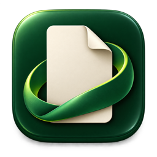
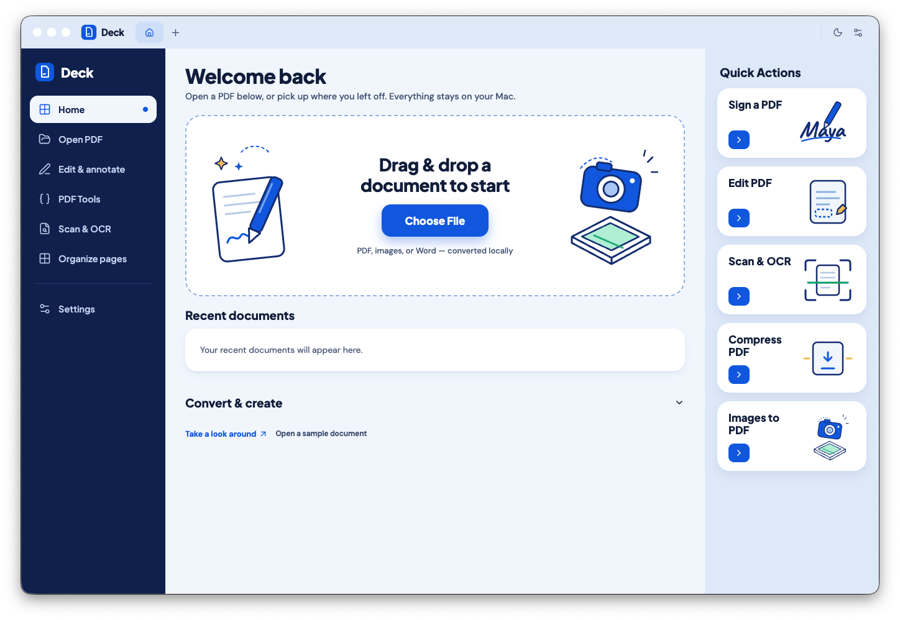

<div align="center">
  
  <h1>Deck</h1>
  <p><strong>A local PDF workspace for macOS. No accounts, no uploads, no telemetry.</strong></p>

  <p>
    
    
    
  </p>
</div>



## Highlights

- **Edit & annotate** — highlight, ink, shapes, arrows, text boxes, and sticky notes, with undo/redo and history.
- **True redaction** — permanently removes underlying text and images.
- **Offline OCR** — Apple Vision OCR up to 100 pages at 300 DPI, tables preserved as Markdown.
- **Sign** — draw, type, or import signatures with automatic background removal.
- **Convert** — PDF ↔ DOCX / PPTX, and PNG/JPEG ↔ PDF.
- **PDF Tools** — compress, split, merge, password, flatten, Bates numbering, form filling, and more.
- **Local by design** — bundled engines, no network required, no analytics.

## Run

Requires Node.js 22.12+ and npm. Apple Silicon only.

```sh
npm ci
npm run dev                      # development
npm run build && npm start       # production build
npm run package                  # unsigned app → release/mac-arm64/Deck.app
```

Use **Take a look around** to open the included four-page sample.

## Shortcuts

| Shortcut   | Action          |
| ---------- | --------------- |
| ⌘O / ⌘S    | Open / Save     |
| ⌘T / ⌘W    | New / Close tab |
| ⌘F         | Search          |
| ⌘Z / ⇧⌘Z   | Undo / redo     |
| ⌘,         | Settings        |

## Limits

Inputs up to 50 MB / 500 pages; up to 40 revisions of history per tab; printing and exports up to 100 pages. Deck is a focused local editor, not full Acrobat parity.

## License

[AGPL-3.0-only](LICENSE). MuPDF is used under its open-source AGPL license — see [THIRD_PARTY_NOTICES.md](THIRD_PARTY_NOTICES.md).
